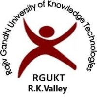
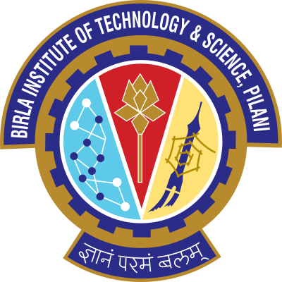

  <h1>Bio</h1>
  
I am currently working as an <strong>AI Engineer at <a href="https://winter.inc/">Winter</a></strong>, where I build intelligent AI solutions with a focus on Generative AI, Agentic AI, and production-ready AI systems. My work spans designing and developing end-to-end AI applications, from backend engineering with Python and FastAPI to LLM integrations, agentic workflows, API development, and deployment.

  
Previously, I worked as a <strong>Machine Learning Engineer at <a href="https://www.hitloop.it/">Hitloop</a></strong>, where I contributed to research-driven AI projects across Speech, Computer Vision, NLP, and Large Language Models (LLMs). My experience includes developing multimodal, multilingual, and multitask AI systems, exploring generative approaches for face synthesis and lip regeneration, building Text-to-Speech (TTS) and Automatic Speech Recognition (ASR) solutions, and working on NLP applications such as machine translation.

  
I hold an <strong>M.Tech in Artificial Intelligence and Machine Learning from BITS Pilani (WILP, 2023–2025)</strong>, which I completed alongside my full-time professional career. I also have a strong research foundation, having previously worked as a research intern at IIT Guwahati.

  
Beyond my professional work, I founded <strong><a href="https://resnur.com/">Resnur AI</a></strong>, a learning and building platform for AI enthusiasts, focused on making AI knowledge accessible and encouraging hands-on exploration of emerging technologies.

  
I am passionate about building practical AI systems, exploring new research directions, and bridging the gap between AI research and real-world applications.

  <ul class="chips">
    <li>Generative AI</li><li>Agentic AI</li><li>LLMs</li><li>Computer Vision</li><li>Speech (TTS, ASR)</li><li>NLP</li><li>FastAPI</li>
  </ul>

  
To connect, send me a <a href="https://www.linkedin.com/in/samarasimhapeyala/">LinkedIn DM</a>, use the <a href="/contact/">contact form</a>, or email <a href="mailto:resnur.labs@gmail.com">resnur.labs@gmail.com</a>. Explore <a href="https://resnur.com/">Resnur AI</a>.

  

    

      
    

    
B.Tech, Electronics & Com.,  IIIT, <a href="https://www.rguktrkv.ac.in/" style="color: #0284c7; text-decoration: none;">RGUKT RK Valley</a>, India Aug. 2018 - May. 2022

  

  

    

      
    

    
M.Tech, Artificial Intelligence & ML, <a href="http://www.bits-pilani.ac.in/" style="color: #0284c7; text-decoration: none;">BITS Pilani</a>, India Nov. 2023 - Oct. 2025

  

    

    

      
    

    
Research Intern  <a href="http://www.bits-pilani.ac.in/" style="color: #0284c7; text-decoration: none;">IIT Guwahati</a>, India Mar. 2021 - Jul. 2021

  

  

    

      
    

    
Software Engineer  <a href="https://www.forsysinc.com/" style="color: #0284c7; text-decoration: none;">Forsys Inc.</a>, India, Jun. 2022 - Apr. 2023

  

  

    

      
    

    
Machine Learning Engineer, <a href="https://www.hitloop.it/" style="color: #0284c7; text-decoration: none;">Hitloop</a>, India Apr. 2023 - May. 2025

  

  

    

      
    

    
Software Engineer - AI Engineer, <a href="https://winter.inc/" style="color: #0284c7; text-decoration: none;">Winter</a>, India Jun. 2025 - Pres.

  

 

  <h2>Research</h2>
  

    My research interest broadly includes <strong>Generative AI, Agentic AI, Computer Vision, Visual Language Models (VLMs) and Speech applications</strong>. I have worked on TTS speech synthesis models for Indic languages, ASR systems, translation language models and face synthesis / lip regeneration. I am actively looking to collaborate on research in Generative AI, Agentic AI, Computer Vision and Speech. Please see the <a href="/cv/" style="color: #0284c7; text-decoration: none;">CV</a> section to know more about my Education, Skills and Experiences.
  

  <h2>Updates</h2>
  <ul class="updates-list">
    <li><strong>[Aug. 2026]</strong> Received my Master's degree from BITS WILP at BITS Pilani, Hyderabad (convocation)</li>
    <li><strong>[Jul. 2026]</strong> Started <a href="https://resnur.com">Resnur AI</a> (<a href="https://resnur.com">resnur.com</a>), a learning and building platform for AI enthusiasts. Its <a href="https://www.linkedin.com/company/resnur-ai">LinkedIn page</a> grew to 12k+ followers in just 3 months</li>
    <li><strong>[Oct. 2025]</strong> Finished my work-integrated M.Tech in AIML at BITS Pilani WILP while working full-time</li>
    <li><strong>[Jun. 2025]</strong> Started a new role as AI Engineer at Winter</li>
    <li><strong>[May. 2025]</strong> Concluded my journey as Machine Learning Engineer at Hitloop</li>
    <li><strong>[Feb. 2024]</strong> Attended two-day India's Biggest GenAI Summit, the Machine Learning Developers Summit <a href="https://mlds.analyticsindiamag.com/"> (MLDS2024)</a> held in Bangalore</li>
    <li><strong>[Apr. 2023]</strong> Started my Master's in Artificial Intelligence and Machine Learning in BITS Pilani, India</li>
    <li><strong>[Aug. 2023]</strong> Elected as an External Secretary for the RGUKT RK Valley Alumni Association (RGURAA)</li>
    <li><strong>[Aug. 2023]</strong> Successfully completed the 30-day <a href="https://cvit.iiit.ac.in/summerschool2023/"> 7th Summer School</a> on AI with a focus on Computer Vision & Machine Learning, hosted by CVIT, IIIT Hyderabad</li>
    <li><strong>[Apr. 2023]</strong> Started new journey as a founding Machine Learning Engineer at Hitloop, India</li>
    <li><strong>[Apr. 2023]</strong> My journey as a Software Engineer at Forsys has ended to purse core research on AI</li>
  </ul>

 

  <canvas id="site-globe" data-src="/assets/globe/countries-110m.json" style="width: 220px; height: 220px; cursor: grab; touch-action: pan-y;" aria-label="Interactive globe centered on Bangalore, India" role="img"></canvas>
  
Drag to rotate &middot; Bangalore, India

  

